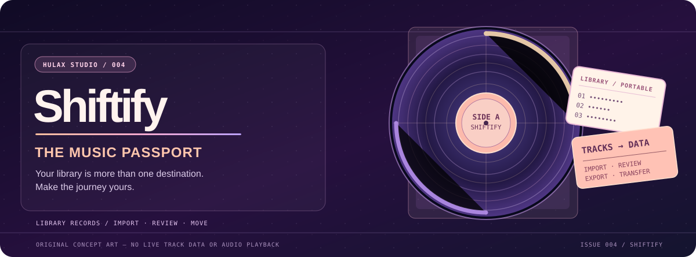
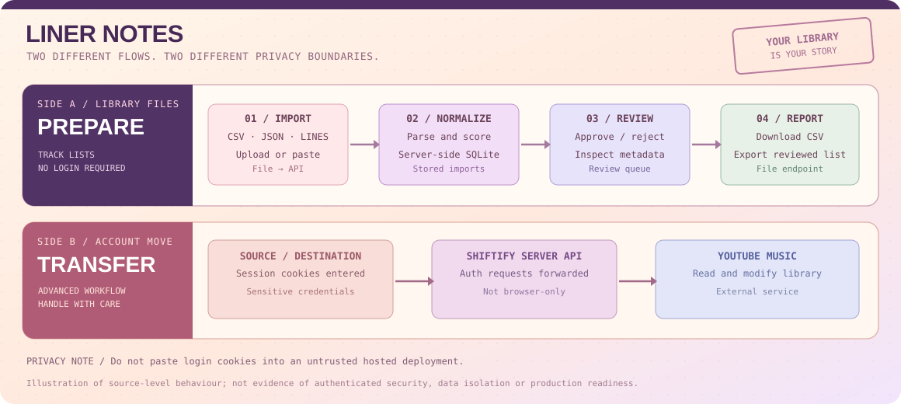

### SHIFTIFY / THE MUSIC PASSPORT

**Your music library is a story. It should be easier to take that story with you.**

A music-library preparation and account-transfer experiment covering **track imports, normalization, review, CSV reporting and YouTube Music account operations**.

[**Explore project website**](https://shiftify.hulax.uk/) · [**Read the liner notes**](#the-liner-notes) · [**Start locally**](#studio-setup) · [**Engineering notes**](#behind-the-sleeve)

Original animated artwork, not actual library data. No audio is embedded.

---

## The liner notes

Music isn't just an account. It's the playlists that shaped your year, the tracks you rediscover and the collections you want to carry elsewhere.

**Shiftify is about making that library more portable.** But the code has two distinct workflows, with very different trust boundaries. They shouldn't be confused.

Conceptual diagram based on checked-in code. Not proof of production security or successful account migration.

### Side A / Prepare your library

For files you already own or have exported.

| Track | What happens | Source |
| :--- | :--- | :--- |
| **01. Import** | Upload or paste CSV, JSON or text lines | [Importer UI](src/app/import/page.tsx) · [Parser](src/lib/importer.ts) |
| **02. Normalize** | Clean artist/title, infer duration and flag invalid rows | [Normalization](src/lib/normalize.ts) |
| **03. Review** | Inspect and approve or reject imported rows | [Review queue](src/app/review/page.tsx) |
| **04. Report** | Generate a CSV report of recorded items | [CSV download endpoint](src/app/api/imports/[id]/report/route.ts) |

**Where the files go:** after submission, the Next.js API processes imports and stores their records in **server-side SQLite**. This is not a wholly browser-only workflow. Storage location and access controls depend on the deployment. See [import handler](src/app/api/imports/route.ts) and [database code](src/lib/db.ts).

### Side B / Move between YouTube Music accounts

The [Transfer interface](src/app/transfer/page.tsx) provides source/destination account controls, playlist browsing, song matching and playlist actions. The [server-side YTM adapter](src/app/api/ytm/route.ts) accepts supplied authentication cookies and sends requests to YouTube Music.

**Security note:** those cookies are session credentials **sent to Shiftify's server**, so an absolute promise that they never leave the browser would be false. Do not paste real account cookies into an untrusted hosted site. Prefer a controlled local deployment only after reviewing the implementation. This project has not had an independent security audit.

This code does **not** establish transfer support for Spotify or Apple Music. The inspected account API targets YouTube Music.

## Four sides of the product

<table>
<tr>
<td width="50%" valign="top">
<h3>Library preparation</h3>

Import, validate, review and export a CSV report.

<a href="src/app/import/page.tsx">Import</a> · <a href="src/app/review/page.tsx">Review</a> · <a href="src/app/runs/page.tsx">Run history</a>

</td>
<td width="50%" valign="top">
<h3>Account transfer</h3>

Browse source collections and attempt destination account actions through a credential-bearing API.

<a href="src/app/transfer/page.tsx">Transfer</a> · <a href="src/app/api/ytm/route.ts">Adapter</a>

</td>
</tr>
<tr>
<td width="50%" valign="top">
<h3>Discovery experiments</h3>

Separate interfaces exploring musical discovery and taste.

<a href="src/app/discovery/page.tsx">Discover</a> · <a href="src/app/library/page.tsx">Library concepts</a>

</td>
<td width="50%" valign="top">
<h3>Party rooms</h3>

Optional Supabase-backed room codes and collaborative playback state; requires configuration.

<a href="src/app/party/page.tsx">Party UI</a> · <a href="docs/party-mode.md">Setup</a>

</td>
</tr>
</table>

These are **source-level capabilities**. Showing a feature in an interface does not automatically establish that it works on the public deployment.

## Behind the sleeve

| Component | Implementation |
| :--- | :--- |
| **Product interface** | Next.js 16, React 19, TypeScript, Tailwind CSS 4, Framer Motion |
| **Library parser** | Text/CSV/JSON, track normalization and review status |
| **Import data** | Next.js server routes and better-sqlite3 storage |
| **YouTube Music adapter** | Server-side authenticated account operations using user-provided session cookies |
| **Collaborative party** | Optional Supabase authentication, tables and Realtime |

### Limits and unfinished tracks

- **Imported data isolation:** the inspected import listing/report endpoints should be audited for per-user authorization before using a shared public server.
- **Credential flow:** account operations use sensitive cookies submitted to an application server. This needs a dedicated security review before encouraging real-account use.
- **Format claims:** the inspected server report route generates CSV. Additional format marketing claims should not be treated as verified exporters.
- **Platform support:** there is no verified Spotify or Apple Music transfer adapter in the checked-in YouTube Music route.
- **Build status:** historical TypeScript error logs are present. A clean production build and current deployment were not verified during this visual redesign.

A trustworthy portability tool should say where data travels, what persists and who controls access.

## Studio setup

Install locally to explore the frontend and file-preparation workflow.

~~~bash
git clone https://github.com/HuLaxx/Shiftify.git
cd Shiftify
npm install
npm run dev
~~~

Visit http://localhost:3000. Use a Node.js version compatible with Next.js 16.

For file imports, the Next.js API requires a writable server filesystem; SHIFTIFY_DATA_DIR can select a data directory, as implemented in [the database module](src/lib/db.ts).

The optional party-room experience needs a Supabase project, anonymous authentication, tables and environment variables: [Party Mode guide](docs/party-mode.md).

**Avoid real authentication cookies until you've reviewed the code, deployment and security implications.** The project site has not been independently verified to be safe for account credentials.

### Work left before a public production launch

- [x] Parse CSV/JSON/text tracklists and normalize metadata.
- [x] Add a review queue and downloadable CSV report route.
- [x] Add source modules for YouTube Music account actions and optional party rooms.
- [x] Label client/server trust boundaries truthfully in this README.
- [ ] Implement and test per-user authorization for stored imports and reports.
- [ ] Audit and replace the sensitive cookie-pasting authentication approach.
- [ ] Run type checks, lint, production build and targeted API tests.
- [ ] Validate actual hosted feature availability and take authentic screenshots.
- [ ] Document data retention, deletion and account security before promoting public use.

[Project-specific creative and engineering checklist](docs/CREATIVE_CHECKLIST.md)

---

### KEEP THE MUSIC. KEEP THE CONTEXT.

By **Rahul Khanke / HuLaX** · [**Portfolio**](https://portfolio.hulax.uk/) · [**GitHub**](https://github.com/HuLaxx) · [**LinkedIn**](https://www.linkedin.com/in/rahul-khanke-853717218/)

Independent portfolio software; not an official YouTube Music integration or a certified migration service.

